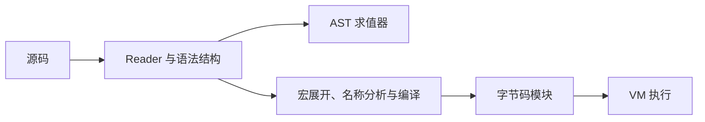

# 读懂 Zio 的执行过程：编译器、VM、GC 各自解决什么问题

日期：2026-10-15。面向没有编译原理背景的读者。文中的小程序和指令用于解释概念，本轮没有重新运行；Zio 当前能力以[语言参考](../docs/language-reference.md)和[特性矩阵](../docs/feature-matrix.md)为准。建议的 GC、暂停与 restart 仍是设计，不是已实现功能。

写语言时最容易混在一起的三个问题是：代码怎样变成能执行的动作、执行到哪里以及值什么时候可以释放。它们分别引出编译器、虚拟机和垃圾回收。它们互相协作，但其中一个完成，不会自动替另外两个解决问题。

## 1. 从一个小程序开始

```lisp
(defn make-adder [k]
  (fn [x] (+ x k)))
(def add10 (make-adder 10))
(add10 5)
```

按 Zio 当前词法闭包规则，最后的结果应为 15。理解这个过程只需要认识几个词：

| 术语 | 在这个程序里是什么意思 |
| --- | --- |
| Reader | 把字符与括号读成表达式结构 |
| AST（抽象语法树） | “定义函数”“调用”“加法”等表达式的结构表示 |
| 环境 Env | 当前名字指向什么值，例如 `k` 指向 10 |
| 闭包 | 一段函数代码，加上它仍需访问的外部绑定 |
| 调用帧 | 一次尚未结束的函数调用的执行记录 |
| 字节码 | 为语言虚拟机设计的较小指令集合 |
| VM | 逐条执行这些指令的程序 |
| GC | 判断哪些受管理对象已无法访问，并回收其空间的机制 |

## 2. 解释器可以直接走表达式

AST 解释器看到 `(add10 5)`，先找 add10 的函数值，再求值参数 5，建立一次调用，把 x 绑定到 5。函数体需要 k，就沿闭包保留的环境找到 10，然后完成加法。

这条路径便于实现 REPL：用户输入一个定义，解释器立即把它放进会话，下一行就可以使用。宏也可以读写代码数据。不过每次执行都需要判断当前表达式是什么、查哪些名字。这只是可能的成本来源，不能仅凭它断言某个 VM 一定更快。

Zio 的 Rust AST evaluator 位于 [eval.rs](../langs/core/src/eval.rs)，环境位于 [env.rs](../langs/core/src/env.rs)。另外还有用 Zio 编写的[元循环求值器](../langs/core/assets/interpreter/evaluator.zio)：“元循环”表示用语言自身写求值逻辑，仍需要宿主提供值、原语与执行机制。

## 3. 编译器提前回答一部分问题

编译器把表达式分析后转换为另一种表示。它可以提前确定 x 在哪个局部槽位、k 从哪个捕获槽位读取、某个调用是不是尾调用。于是执行时不必每次重新做同样的语法判断。

函数体 `(+ x k)` 可以概念性地转换为：

```text
取局部参数 x
取捕获绑定 k
调用 +，参数个数为 2
返回结果
```

这是教学伪指令，不是 Zio 实际 opcode 名称。真实前端在 [analyze.zio](../langs/core/assets/compiler/analyze.zio) 和 [compiler.zio](../langs/core/assets/compiler/compiler.zio)，执行机制在 [bytecode.rs](../langs/core/src/bytecode.rs)。



图中的两条路径有同一份语言合同。宏在哪个阶段运行可能有合法差异，所以比较解释和编译执行时，需要分别检查最终值、错误、输出与展开阶段，不能只比较最后一行打印。

“编译”也不必然表示生成 CPU 机器码。编译到 bytecode 后由 VM 执行是一种编译；生成 CPU 指令再运行是另一种。JIT 是在运行期间生成机器码，AOT 是提前生成。Zio 当前单文件 native 应用使用 runtime 加 payload 打包，不能因此称为机器码 AOT。

## 4. VM 把“执行到哪里”变得显式

一次调用至少要知道：正在执行哪个函数、下一条指令、局部变量、临时计算值，以及返回后去哪里。VM 通常把这些信息放在自己的调用帧与栈中。这里的“栈”是语言运行时的数据结构，不一定等于 Rust 的原生调用栈。

这样做有利于观察调用、限制指令预算、表示尾调用，也为单步调试和暂停提供基础。但能够执行 bytecode，不代表当前实现已经支持任意时刻暂停：还有 native callback、异常处理链、资源清理等状态需要一并保存。

尾调用是在当前函数的最后一步调用另一个函数；结果回来后已经无事可做，因而可以替换当前帧。它解决某些递归的栈增长，**不负责回收所有堆对象**，也不保证普通递归都使用常量空间。

## 5. 闭包让值活得比调用更久

`make-adder` 返回后，add10 仍然需要 k。只把 k 放在已经退出的调用帧里是不够的，必须让所需绑定继续存在。Zio AST 闭包保留 Env，compiled 闭包使用捕获的 binding cell；如果多个闭包修改同一个绑定，应看到同一个单元。

这就是“栈”和“堆”的区别之一：调用帧可以按调用顺序退出，但闭包和对象的寿命常常没有这种顺序。它们可能被别的函数、模块、会话或宿主句柄继续引用。

当前 [Value](../langs/core/src/value.rs) 和 compiled Closure 使用 Arc/Rc 等引用管理机制。引用计数记录“还有多少强引用”；计数降到零就能释放。然而 Rust 内存安全并不保证没有引用环泄漏，官方书籍也明确讨论了这种情况。[Rust：引用环与内存泄漏](https://doc.rust-lang.org/book/ch15-06-reference-cycles.html)

例如概念上的这组关系：

```text
环境 Env → 函数 f → 捕获的 Env
```

当外界不再使用它们时，环里的成员仍互相持有，计数可能都不归零。Zio 已在 [ADR-015](../docs/adrs.md)记录这一问题。把所有捕获改成 Weak 也不等价：Weak 不保证对象活着，可能让本应继续工作的逃逸闭包失去环境。

## 6. 追踪式 GC 从“还能找到谁”出发

追踪式 GC 的一个基本方案是 mark-and-sweep：先从 roots 找到仍能访问的对象，沿引用标记它们；再回收没有标记的受管理对象。roots 是运行时认定仍然有效的入口，例如活动调用帧、模块绑定、宿主持有的对象句柄。

它能够处理没有外部入口的环：环里的对象互相认识，但从任何 root 都走不到它们，就可以一起回收。实现时必须列全引用边和 roots；少列会误回收仍在用的对象，多列则可能保留不再需要的对象。

| 选择 | 带来的工程问题 |
| --- | --- |
| 非移动 GC | 对象地址不因收集改变，通常更容易对接现有宿主引用；仍需 roots 与扫描协议 |
| 移动 GC | 可整理空间，但移动后要更新引用，或通过稳定 handle 间接访问 |
| 分代/增量/并发 GC | 分别优化常见分配行为、停顿或并行工作；需要额外屏障与一致性规则 |
| RC 加环检测 | 可保留部分现有管理方式，但同样要能识别对象之间的引用 |

这几种不是互相排斥的全部选项。当前建议是先验证一种足够简单、可回收环的方案，衡量堆大小、分配量和停顿，再决定是否增加高级机制。不要一开始就把设计目标写成“零停顿高性能 GC”。

GC 也不能代替文件和 socket 的及时关闭。资源释放需要明确的生命周期和清理语义；自动回收内存的时点不适合作为释放外部资源的唯一保证。

## 7. 为什么 AI 交互会影响 GC 和 VM

如果程序在 condition 处暂停，等待 Agent 选择 restart，当前调用帧、局部值、恢复点和必要资源仍然有效。它们必须成为 roots。否则 Agent 思考期间发生一次 GC，就可能把恢复所需数据收走。

同样，取消后要解除这些 roots，执行必要清理并使句柄失效。工具返回了 JSON，不代表原执行现场已被保存；远程句柄也不等于可以持久化的 continuation。

现有镜像保存的是约定静止边界的对象图，**不保存任意在途调用栈**。镜像恢复、暂停后继续、进程崩溃后恢复是三个不同合同。我们可以先支持同进程的有限恢复点，而不同时实现任意续体或进程级快照。

## 8. 怎样理解自举

用 Zio 写的编译器编译自己的源码，生成下一代编译器；下一代再编译相同源码，得到可比较的规范制品。这有助于验证编译器不是只对几个示例有效，也说明语言足以表达自己的前端。

但固定点不能独自证明编译器没有 bug：不同代可能保留同样的错误。所以还要执行已知答案程序、比较解释与编译行为、测试非法输入。它也不能证明运行时脱离 Rust，或者程序自然拥有更好的性能。Zio 的实际检查见[自举合同](../langs/core/tests/self_hosting.rs)。

## 9. 接下来读什么

先看[语言设计决策](../docs/language-design-decisions.md)中的 D10/D11/D12，理解哪些是已存在机制、哪些是待决策方案；再看[生态路线图](../docs/ecosystem-roadmap.md)里的运行时门槛。要理解为什么 AI 的错误恢复不宜只靠重新生成代码，接着读[condition/restart、help、harness 与 MCP](06-restarts-help-harness-mcp.md)。
