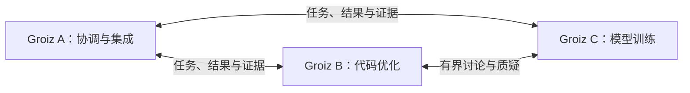

# Groiz 群体协作：独立实例的联结、分工与讨论

日期：2026-10-15。状态：**用户提出的架构方向，本文为待评审草案**。没有实现联邦服务、启动多个实例或发送任何协作消息。

关联：[持续自我进化设计](continuous-evolution-design.md) · [AI 交互设计](ai-language-interaction.md) · [决策 D27～D30](language-design-decisions.md) · [路线图](ecosystem-roadmap.md) · [入门博客](../blog/08-collective-intelligence.md)。

## 1. 群体的基本单位是独立 Groiz 实例

用户目标是多个 Groiz 可以相互联结、分工并讨论。建议实例各自拥有身份、目标、快照、模型/脚手架、记忆、任务、存储和预算，可以单独运行，也可加入一个或多个协作组。角色按任务和能力分配，不写死为不同的语言类型。

| 单位 | 拥有什么 | 与其他单位的关系 |
| --- | --- | --- |
| worker | 某个 owner 授予的执行槽位与 attempt | 执行实例内部任务，不自动成为自主成员 |
| branch/population | 研究分支、候选、检查点和共享研究账本 | 一个 Groiz 内可同时探索多条方向 |
| Groiz instance | 独立服务/研究平面、状态、版本、权限与资源 | 接受或拒绝协作任务，可独立演化 |
| collaboration group | 共同目标、成员/角色、任务、讨论、预算分配与决策规则 | 组织多个实例；不自动拥有成员所有数据和权限 |

首轮假设是同一所有者管理的三个已知实例，可在同机不同进程/数据根启动；不要求先构建开放式互联网 Agent 网络。身份和数据边界仍保留，以便后续扩到多机或不同所有者。

## 2. 已有基础与缺口

基线延续前一轮：Groiz `33673b1e10ff8e5f43d244c4e1ed7a9d4e5c1d46`，Zio `acdbd48cca70cac6301172442a101a61623b8134` 加未提交设计草案。本轮为源码/合同检查，未重跑群体或网络测试。

- Groiz 的 [coordinator](https://github.com/lszio/groiz/blob/33673b1e10ff8e5f43d244c4e1ed7a9d4e5c1d46/native/learning/src/coordinator.rs) 与 [population 合同](https://github.com/lszio/groiz/blob/33673b1e10ff8e5f43d244c4e1ed7a9d4e5c1d46/native/learning/tests/population_contract.rs)围绕一个 store、owner、共享预算和 worker attempt，可借鉴 lease、去重、失效与结果提交；它们没有单独证明多自主实例联结。
- [`population.zio`](../libs/learning/learn/population.zio)是分支保留/暂停的纯策略，不能直接视为网络发现、任务委派或讨论协议。
- Loom 已有模型/工具会话与预算合同；[`acp.zio`](../libs/loom/acp.zio)有 JSON-RPC、会话和 transport 钩子，但其注释命名与仓库其他文档中的 ACP 名称并不一致，且默认 transport 存在缺绑定时降级路径。需要明确协议身份、锁定版本并真实互通，不能把自定义方法集自动称为标准兼容。
- 前面的 MCP 设计提供语言工具入口；它不自动规定实例身份、任务所有权、讨论结束条件、共享预算或群体采用政策。

尚缺 Peer/Group/Delegation/Discussion/Decision 数据模型、可靠收发与成员边界、跨实例结果/制品交换，以及群体相对单实例的收益验收。

## 3. 拓扑选择

| 路径 | 适合什么 | 取舍 |
| --- | --- | --- |
| 每任务组有协调者，成员实例独立（首轮建议） | 分工清楚、结果可追踪、预算可核对的小型协作 | 协调者需持久记录和恢复；控制面不可用时不能假装任务所有权仍能任意更新 |
| 点对点组网、按任务临时协商 | 多所有者、动态加入、更自由协作 | 发现、冲突、计费和决策协议更复杂，另行验收 |
| 单 Groiz 管理多 worker/分支 | 单实例内部研究并行 | 继续保留此模式；它不替代独立实例的协作合同 |

“协调者”是某个组某个 epoch 的职责，不是所有 Groiz 的永久主脑。A 可以协调一个组，同时作为另一组的成员；各实例自己的采用和资源边界保持独立。

成员也可以在已配置的联结/消息范围内主动邀请协作、发起议题、请求审查或分享发现，不要求所有交互都由协调者先点名。接收方可拒绝、暂停参与或限制频率；自主发起仍按各实例资源和组规则记账。

图示为候选组织方式；三者各有数据根、快照和预算，共同议题/委派/决定进入协作组日志。讨论也可经组通道交换，不要求每两个实例都建立直连。

首轮由组的持久记录维护唯一有效 owner，重启从该记录接管；不宣称已实现跨机自动选主或高可用共识。未来需要多控制节点容错时，再为组记录引入经过验证的一致性机制。

## 4. 核心对象与消息

| 对象 | 最小内容 |
| --- | --- |
| PeerDescriptor | 稳定 instance ID、可验证身份、endpoint、协议/schema 版本、能力/目标、当前可用状态及卡片修订 |
| GroupContract | group ID、目标/任务合同版本、成员与角色、数据/工具范围、预算、讨论/决策/采用规则、截止条件、配置修订 |
| DelegatedTask | 父任务、输入/输出合同、精确基础快照/依赖、受托方、配额/截止时间、结果要求与幂等键 |
| Assignment/Attempt | offer/accept 状态、owner epoch、attempt ID、有效期、进度/结果摘要；结果对应固定执行版本 |
| Discussion | 议题、参与者、阶段、轮次/成本上限、提案/证据/异议/修订与结束状态 |
| DecisionRecord | 采用/继续实验/延期/拒绝/保留分歧，引用具体证据、规则修订与做决定的身份 |
| ArtifactOffer | 不可变代码/模型/脚手架/经验引用、摘要、来源/许可、兼容条件和可获取范围 |

能力卡片是声明，接单时还需按本地真实能力、预算和授权确认。instance ID 不是来源字段自己填一个名字；身份由选定的可信连接/凭据映射验证，首轮只配置已知成员，不先做开放信誉市场。

消息信封包含 message ID、sender/recipient、group/task/discussion ID、类型/schema、correlation/causation ID、组修订与必要 epoch、payload/artifact refs、预算/截止描述。来源时间可辅助观察，不能只凭各机器时间戳决定全局先后或所有权；明确顺序由任务/讨论记录的版本推进。

## 5. 分工是可接受、可拒绝的委派

1. 协调者依据能力将任务拆成可验证输出，提出 offer，并预约本组可分配额度。
2. 接收实例按本地策略接单或拒绝；只有接单持久化、任务代际有效后才执行，未收到回应记 pending/unknown。
3. 执行使用固定快照与精确输入，进度和消耗以带 attempt/epoch 的消息上报。
4. 结果附制品、环境/版本、测试/评价证据和限制；ack、接收结果、认可质量与最终采用是不同状态。
5. 取消/超时使 assignment 失效，重新分配产生新 attempt；旧实例的迟到结果可留作材料，但不能推进已被接管的任务或产生重复采用。

发送方把 offer 持久化并放入待发送队列（outbox），接收方把消息与去重记录写入 inbox 后再处理。网络重投按“至少一次”设计，业务结果、账单和决定按 ID 去重；不承诺不同实例或外部服务之间天然恰好执行一次。

租约的有效性和提交由选定控制记录/epoch 校验，不依赖两台机器的时钟恰好相同。失联但可能已产生的外部动作记 unknown，通过查询/对账/补偿解决，不为拿到确定回复盲目重做。

每个实例保留自己的总账；组只持有被明确分配/预约的份额。转包或加入第二个组不能复制预算；同一资源只有一个计费权威，组侧汇总分配与成员实际消耗，避免重复计费。控制账本不可用时，不继续发放需要强额度保证的新授权；已有任务按预留范围执行或等待。

## 6. 讨论需要议题、证据和结束条件

讨论可用于任务分解、方案选择、代码审查、模型/数据诊断、脚手架重组和失败复盘。最小消息类型为 question、proposal、evidence、critique、revision、decision；“我同意”可以记录，但不等于执行证据。

讨论不必总绑定一个工作任务，也可以围绕成员主动发现的问题、经验或研究方向建立议题。长期频道保留历史，以有界 episode 推进；一个 episode 可以只产出新问题或经验，不强迫每次聊天都修改代码或形成全体结论。

建议过程：固定议题与评价目标 → 各实例先独立提出方案 → 共享必要证据并交叉质疑 → 限轮修订 → 记录结论、未解决异议及下一步。独立首轮有助于保留不同方法，后续共享不应抹掉其原始来源。

规则可以是指定责任者决定、按明确权重投票、通过外部测试选优或保留多个候选；没有一种对所有任务都正确。代码/模型质量最终仍按固定评价合同判断；多个相似模型的一致答案可能来自同一错误，不能简单当成多个独立证据。

达到轮次、时间、token/费用上限后结束或延期。无法判定时可以记录分歧、安排有预算的实验，或交给所有者决定；不自动开始无限的新一轮讨论，也不把“最终总结”伪装成全体一致。

讨论消息始终是有来源的数据，不能借成员身份变成另一实例的系统指令。讨论得出的方案如果会调用工具、训练或采用版本，仍需生成显式任务/决定并由对应执行边界校验；发言本身不触发动作。

## 7. 共同知识与共同演化

默认交换可授权的知识、反例、实验记录和不可变制品引用，不共享整个数据库、可变堆或任意运行时句柄。经验保留原始来源、转换、任务/数据/评价版本、许可与撤回信息；A→B→C 的转述仍指向 A，不能被计作三个独立来源。

成员可共享通过本地验证的函数、模块、脚手架片段或模型 adapter。接收方校验摘要、依赖/语义空间、能力需求与适用任务，在自己的上下文里重新评价后决定采用；“由可信成员发来”不等于在本地必然更好。

多成员可训练不同候选、交换教师输出或产生组合快照；这不自动成为联合梯度训练。任意模型权重不能直接平均；同架构也仍需参数/谱系对齐和整体评价。分布式优化器、跨机训练或联邦训练另设后端合同，不作为最小讨论/分工群体的前提。

群体自己的角色分配、路由、讨论策略和工具组织也可以成为脚手架候选，并纳入版本化 GroupContract/快照。正在执行的任务绑定组配置修订，新配置应用到新任务；采用仍遵循前文的人/策略决定，不让一次讨论隐式重写活动任务规则。

## 8. 与 Zio、Loom、MCP、restart 的关系

| 层 | 负责什么 |
| --- | --- |
| Zio | 可读可编译的消息/策略/脚手架表示、执行、错误与宿主边界 |
| 通用 harness/宿主 | 会话/持久任务、可靠 I/O、预算、worker 与有界结果 |
| Loom/协作库 | Peer/任务/讨论协议适配、能力发现、路由、讨论策略和证据组织 |
| Groiz 应用 | 群体目标、角色、评价、知识共享与本地/群体采用政策 |

MCP 可以暴露成员可调用的工具与查询，ACP 可作为经验证的会话适配候选；**两者都不能替代本文的任务所有权、计费与决策合同**。首轮先定义带版本的内部协作合同，按实际选择的协议做互操作适配，避免借用标准名称掩盖自定义 wire。

远程实例可帮助分析 condition，并提出某个 restart 的选择；实际恢复仍在原 owner 的 run 中校验 session/run/epoch 和有效范围。不能把 restart 句柄作为可在任意实例执行的闭包，也不因成员失联就声称原执行栈已迁移。长时协作等待应使用 durable waiting/job，按需要保存检查点。

## 9. 最小样板与验收

三个真实 Groiz 进程：A 负责协调/集成，B 擅长代码优化，C 擅长小模型训练。它们的数据根、身份、预算与快照独立；角色是这次协作的分配。固定任务要求同时满足质量与成本门槛。

A 拆分任务，B/C 分别接单并产生证据；三者讨论两轮以内，比较代码、模型和脚手架候选，保留分歧；独立评价产生合格组合，按原有采用策略处理。没有已确认的自动采用授权时，演示停在 qualified，不伪称正式采用。

| 工作包 | 交付与通过条件 |
| --- | --- |
| COL-01 身份与联结 | 三进程握手/版本协商/能力查询；身份/组范围校验，成员退出或不支持版本清楚可见 |
| COL-02 分工与账本 | offer/accept/decline、租约、outbox/inbox、取消/去重与配额；重复投递不创建第二份有效任务或重复账目，外部动作未知时对账，转包不复制预算 |
| COL-03 有界讨论 | 独立提案、证据、质疑、修订、决定/分歧；轮次和费用上限生效，发言不直接改变采用状态 |
| COL-04 成果交换 | 代码/模型/脚手架/经验制品引用与来源，接收方验证/评价；转述不增加证据独立性，未知依赖拒绝 |
| COL-05 故障与收益 | 成员掉线、组 owner 重启、网络分区、重复/乱序/迟到消息；旧结果不覆盖接管任务，超时结束、资源释放 |

收益比较至少有：单实例、相同总资源的单实例多分支、多个实例分工、分工加讨论。比较固定质量目标下的成功率、总模型/训练成本、延迟、重复劳动、纠错与错误放大；不能只给群体更多预算就宣称智能提高。

不要求首轮开放发现、跨所有者交易、全网共识或多机联合训练。先证明独立实例能真实分工、讨论和交换成果，再按需求扩展拓扑。Groiz 原仓库在本轮保持不变。

## 10. 设计边界与研究证据

图查询使用 `zio` 当前代码基线和 `/tmp` 的 `groiz-review` 固定快照，定位 population/coordinator、会话/transport 相关合同；直接读取 Zio 脚本补充图覆盖不足处。Coordinator 的图 context 不含可用调用集，不将其解释为未使用。新增文档无既有图节点，影响为 UNKNOWN，链接与内容另行核对。

本轮只完成设计，不把已有 population、文件内协议注释或 MCP 计划作为跨实例功能已交付的证据。真实网络/进程故障、讨论有效性和预算合同需在 COL-01～05 实现时运行验收。
