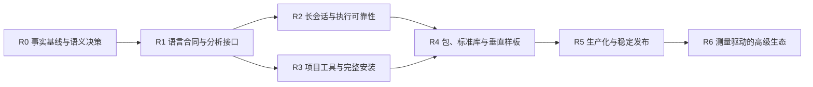

# Zio 完整语言生态路线图

> 2026-10-16：当前聚焦语言本身，按[Zio 后续任务清单](zio-task-list.md)安排优先级。下文保留完整需求；Groiz 的演化与群体协作作为外部验收场景，不全部列为语言发行前提。

日期：2026-10-15。状态：**建议路线图，待采纳**。范围包括语言、编译器、执行器、开发工具、库、包与发行；实现依据见[评审](language-ecosystem-review.md)，设计取舍见[决策清单](language-design-decisions.md)。

现有[工具链工作包](superpowers/plans/2026-10-11-zio-language-toolchain.md)继续管理 L/M/A/J/R/E/D 任务；本路线图给出生态层面的依赖和验收，不复制其勾选状态，也不宣称替代已采纳方案。采纳后再把新增工作拆为 issue，将重叠任务链接回原工作包。

用户补充方向已纳入：[AI 交互设计](ai-language-interaction.md)。condition/restart、help/结构化查询、语言执行 harness 与解释器 MCP 服务成为早期主线，不再把 restart 推迟到高级生态；新增接口仍是设计目标，尚未实现。入门解释见[编译器、VM 与 GC](../blog/05-compiler-vm-gc.md)及[restart/help/harness/MCP](../blog/06-restarts-help-harness-mcp.md)。

进一步目标是持续运行、自行优化代码、训练模型与组装脚手架。[Groiz 技术对照](continuous-evolution-design.md)指出当前设计尚缺持久任务、联合快照、训练后端和采用闭环，新增 EVO-01～07；这些需求进入 R1～R5 的应用验收，不等全部高级生态完成。自动采用作为待确认政策，与 Groiz 现行人工批准严格区分。

多实例联结、分工与讨论见[群体协作设计](collective-intelligence-design.md)，新增 D27～D30 与 COL-01～05。首轮先验证三个已知实例的独立状态/预算和可恢复协作；开放网络发现、多控制节点共识与联合模型训练分别演进，不作为基本分工/讨论的隐含前提。

## 1. 完整生态的完成标准

首个用户旅程建议是：干净机器安装 → 建项目 → 写库/程序 → 加依赖 → 编辑器诊断 → 测试 → 编译/运行 → 打包 → 移出仓库运行 → 发布一个可被他人使用的库 → 升级仍可复现旧构建。

AI 用户旅程同时作为验收主线：Agent 查询当前能力与函数 → 编译/运行小实验 → 观察类型、来源、输出与预算 → 在 condition 处查询 restart → 选择恢复并完成同一次计算 → 保存可复查记录。人类 REPL 与外部 MCP client 共用这些能力；恢复须保留所需现场，不能用从头重跑替代。

持续演化用户旅程：稳定快照持续服务 → 反馈进入持久研究任务 → 分别生成代码/模型/脚手架候选 → 独立评价 → 按明确政策采用完整快照 → 观察或回退；经历 worker/owner 重启后仍能从已提交检查点继续，活动服务不被失败候选覆盖。

完整生态不是每项语言研究都已完成。第一稳定版应满足：公开语义有版本、支持目标真实验收、项目/依赖可复现、长会话不会因常见引用环持续增长、错误能定位、开发工具可用、标准库可组合、库可独立发布、兼容政策可执行。完整 MOP、JIT、所有外部语言、GPU/分布式库可按独立合同演进。

规划命令如 `zio new/add/test/check/doc` 是候选接口，**当前不可假定已支持**；实际命令查语言参考与 CLI usage。manifest 格式、包扩展名和 registry 协议尚待 D15 决策。

## 2. 生态边界

| 层 | 应承担的能力 | 稳定边界 |
| --- | --- | --- |
| 语言规范 | 值、名称、求值、宏阶段、模块、condition/handler/restart、ZOS 最小机制 | 版本化语义语料；恢复的动态范围与控制转移明确 |
| 编译器 | reader/syntax → expand → resolve/analyze → bytecode；后续可扩 IR/backend | 编译输入、诊断与 source map、模块格式、缓存身份 |
| 执行器 | VM、堆/GC、调用/尾调用、任务、宿主调用、镜像恢复 | 值与 identity、roots、资源生命周期、能力与预算 |
| 开发工具 | CLI、REPL、help/查询、执行 harness、MCP、fmt、check、test、doc、LSP、debugger、profiler | 同一项目配置/符号元数据；会话、预算、暂停与恢复句柄明确 |
| 库 | std、官方包、第三方包；原生机制由 adapter 提供 | 模块导出、API/包版本、目标与能力需求 |
| 交付 | 工具链分发、应用构建、包发布、缓存/registry、离线安装 | manifest、锁文件、格式/ABI 协商、校验和/许可证 |

## 3. 依赖与并行边界

R2/R3 可在共同合同固定后独立推进；项目与包的设计可以在 R0 开始。现有自举/镜像成果贯穿所有阶段，不重新排成从零开发。库可以先试用，但稳定 API 依赖 R1；长驻服务依赖 R2，独立包发布依赖 R3/R4。

## 4. 阶段及退出条件

| 阶段 | 主要交付 | 退出条件 | 与现有任务关系 |
| --- | --- | --- | --- |
| R0 · 基线与设计收敛 | 消除状态矛盾，语言核心章程，首轮 D02/D04/D06/D07/D09 RFC，支持目标表 | 每项状态连到证据；break/compat 清单明确；新建议与当前行为分开 | 核对 L00、ADR-014/015、A01/A02 与 D00/D01；不重复 L02 |
| R1 · 语言合同与统一前端 | 模块/宏阶段/数值合同、最小 condition/restart、结构化查询/符号元数据，分析接口与迁移 lint | 普通运行行为共测；本地未退栈 handler 能选择动态 restart；查询不执行代码；LSP/compiler 解析相符；自举不回退 | 扩展 L00–L02；AI-01/02；J01 共用绑定；E00 等待 syntax/phase 合同 |
| R2 · 执行可靠性 | heap/roots 与环回收、资源生命周期、语言实验 harness、预算/取消、暂停帧和远程恢复；隔离 VM 实验 | 逃逸闭包/暂停帧存活；长会话堆稳定；恢复不重复前置副作用，旧句柄拒绝；取消清理可观察；镜像身份保持 | ADR-014/015、M00–M02；AI-03/05；远程恢复不能靠现有静止镜像冒充 |
| R3 · 可安装的项目工具链 | 默认开发包、项目模型、REPL/help/fmt/check/test/doc/LSP、MCP adapter、目标模板/缓存 | 干净安装完成已承诺工作流；MCP 真客户端查询/编译/运行，输出不污染协议，会话不串用；远程恢复按实际能力声明 | D00/D01、AI-04；A01 浏览器/离线资源、A02 无用户 Rust 构建；与 R2 可并行 |
| R4 · 包与库闭环 | path/git 解析、锁文件、内容摘要、离线缓存、库文档；std API 收敛；Rill 样板 | 两个独立项目可消费同一发布库；清空 checkout 后离线复建；冲突/版本不匹配明确报错；发布与应用不共享隐式状态 | 新增包管理工作包；现有 Rill/Numa/Loom 合同按成熟度接入 |
| R5 · 生产化候选到 1.0 | 源码级调试、分配/CPU 分析、兼容矩阵、运行预算、发布归档验收、升级指南与治理 | 每个声明目标真实运行；持续会话、坏输入、拒绝路径通过；语言/包/制品的升级与回退可演示；发布证据齐全 | D01 及新增 debugger/profiler/compat 工作包；可选 Rust engine 的稳定承诺由单独 E2 决定 |
| R6 · 高级生态 | 按 profiling 决定优化 IR/JIT/AOT；更完整 MOP、Rust/其他引擎、registry、Numa/Loom 扩展 | 各自真实需求、基准、复杂度预算和兼容验收；不以“做完整语言”无限加入必选特性 | R00/E00 若已纳入既有工具链范围仍须完成；可用分层发行，不能把缺项改名为已交付 |

不承诺旧 Phase 的周数。R0 完成后，为每个工作包记录负责人、可用投入、依赖、风险和测量结果，再估算日历。自举、GC、并发和调试高度耦合，不能用源码行数或测试数量推导完成日期。

## 5. 建议立即建立的待办

| 顺序 | 工作包 | 明确产出 | 验收与阻塞 |
| --- | --- | --- | --- |
| 1 | EKO-001 状态与规范索引 | 修正文档概述冲突；一张执行入口/目标/制品/组件状态表 | 逐项链接现有证据，区分源码存在、引擎实跑、目标实跑、发布可用 |
| 2 | EKO-002 名称与模块 RFC | D02/D04：binding、set!、import、alias、live/snapshot、重载规则 | 用现有 std/Rill 写迁移例子；先采纳再改三执行面与 LSP |
| 3 | EKO-003 宏阶段 RFC | D05/D06：syntax identity、跨模块 helper、展开输入与能力 | 同名遮蔽、调用/定义来源和缓存失效语料；禁止开文件执行宏 |
| 4 | EKO-004 值与错误 RFC | D07–D09：equal/hash、溢出、Set/ZOS 身份、catch/清理 | equal/hash 性质、异常 cause、清理失败/取消语料；标明 breaking 边界 |
| 5 | EKO-005 运行时生存图 | D10/D11 roots/handles/messages 文档与最小堆原型 | 证明循环回收和逃逸闭包有效；与镜像、native callback、线程隔离共同验证 |
| 6 | EKO-006 项目和包 RFC | D15/D18：manifest、锁文件、包身份、缓存键与兼容表 | path 包 + git 固定 revision/内容校验 + 离线解析；先验证无需 registry 的闭环 |
| 7 | EKO-007 发行缺口收尾 | D00/D01 子任务；浏览器资源闭包、WASI runtime/payload 装配方案 | Linux 当前目标先干净安装；macOS/Windows 必须有机制实现和实跑才标支持 |
| 8 | EKO-008 垂直样板 | 一个 CLI 工具 + 一个被两项目消费的库 + 一个带状态的嵌入会话 | 不借 checkout/隐式 PATH；测试、文档、打包、依赖锁定都通过；收集开发痛点 |

前四项以小 RFC 与语义语料为交付，避免在决策前重写整个编译器。EKO 编号只是本路线图的建议工作包，尚未创建外部 issue。

### AI 交互工作包

完整定义与拒绝边界见[AI-01～06](ai-language-interaction.md)。建议顺序为：AI-01 查询 + AI-02 本地 condition/restart → AI-03 执行 harness → AI-04 MCP 基础 → AI-05 跨调用恢复 → AI-06 Agent 探索基准。AI-02 与 AI-03 可按固定接口分别推进。

AI-04 不必等待所有远程暂停机制完成，可先把已支持的查询/编译/运行交给外部 Agent，并报告 `remote_restart: false`。AI-05 要求原运行现场仍有效、暂停 roots 可追踪、选择校验/去重和退出清理真实完成；以再次执行源码替代不算通过。对编译知识不熟悉的贡献者，相关工作包应链接前述博客并解释新增运行时概念。

### 持续演化工作包

| 阶段落点 | 新增工作 | 通过条件 |
| --- | --- | --- |
| R0/R1 | EVO-01 canonical Groiz 路径核对；EVO-03 联合 snapshot、版本化名称/模块与状态合同 | 模型调用/评价/发布能定位到真实执行和提交；回执不代替结果；确定版本切换边界 |
| R2/R3 | EVO-02 durable job、epoch/lease、预算、故障接管，与通用 harness/MCP 接口 | 杀 worker/owner 后恢复已提交进度；旧结果拒绝；unknown 状态可查；长期等待不只靠活 VM 栈 |
| R2/R4 | EVO-04 训练后端、模型/optimizer/data checkpoint；EVO-05 代码与脚手架候选 | 真实小模型训练/续接；工具/记忆/路由可重组且依赖/效果闭包明确；保持能力边界 |
| R4/R5 | EVO-06 评价/采用策略、预热/drain、状态迁移与回退；EVO-07 长期样板 | 新旧运行不混版，改进有独立证据，失败候选不影响稳定服务；资源曲线、恢复耗时与副作用可检查 |

具体定义和代码证据见[持续演化设计](continuous-evolution-design.md)。先串起最小样板，不先实现全模型/GPU/分布式框架。Groiz 保持独立应用；只把真实复用的任务、执行、制品与计算接口下沉到 Zio 库/宿主。未确认自治模式前不变更既有人工采用策略。

### 多实例协作工作包

| 阶段落点 | 工作包 | 验收 |
| --- | --- | --- |
| R2/R3 | COL-01 身份、版本与能力联结；COL-02 委派、消息与账本 | 三个独立 Groiz 进程接单/拒绝、重复/迟到消息去重，任务可查询/取消；转包不复制预算 |
| R3/R4 | COL-03 有议题/证据/限额的讨论；COL-04 成果与知识交换 | 独立提案、质疑、决定/分歧可追踪；共享制品有来源与兼容验证，消息不直接触发采用 |
| R5 | COL-05 故障与群体收益 | 掉线/重启/分区后不错误提交或重复计费；按相同总预算比较单实例、多分支、分工和分工加讨论 |

这些是独立应用/协作库的任务，Zio 提供数据、执行与宿主边界。Groiz 现有 population 可继续用于每个成员内部搜索；多实例层复用 durable job 和快照协议。MCP/ACP 适配按实际标准版本另验收，不能仅因文件名存在就标跨实例兼容已完成。

## 6. 标准库与官方库的顺序

| 优先级 | 内容 | 第一轮边界与验收 |
| --- | --- | --- |
| P0 基础 std | 集合/序列、文本/Unicode、数值转换、错误/结果、bytes、模块基础、测试 | API 规则与复杂度/遍历次序明确；native/browser/WASI 的 portable 子集共测 |
| P1 宿主 std | 文件/路径、时间、随机、进程、网络和资源管理 | 时间/随机可注入；宿主能力拒绝明确；浏览器缺进程不模拟成功；每项有目标表 |
| P1 开发体验 | assert/test runner、doc 示例、项目配置、序列化、CLI 参数 | 将 Rill 作为首个官方包样板；序列化纯数据与镜像对象图分开 |
| P2 领域扩展 | Numa 数组/数值、Loom 模型/工具/会话、Datalog、learning | 独立版本与支持矩阵，业务留在库；不把实验 demo 宣称完整框架 |

“核心最小”应以语义机制数量和稳定边界衡量。常用功能可以随开发包提供为 Zio std 库，不必都变成特殊形式，也不必都强迫用户联网安装。

## 7. 必须维护的验收矩阵

| 轴 | 至少覆盖 | 必须区分 |
| --- | --- | --- |
| 执行面 | Rust AST、Zio 元循环、显式 bytecode VM | 普通运行结果一致 vs 合法阶段差异；不能静默 AST 回退 |
| 输入 | 源码、便携模块、镜像 | 新会话、坏版本、损坏输入、共享可变状态与未知宿主句柄 |
| 目标 | 已声明 native 平台、browser、WASI | 构建通过、引擎运行、真实目标运行、离线分发分别记证据 |
| 语义 | 值类别/等价、绑定、尾调用、模块、宏、ZOS、错误 | 值、错误 payload、source revision/span、输出及资源状态分别比较 |
| 工具 | CLI、REPL、fmt、check、test、doc、LSP；后续 DAP | 项目配置一致、Unicode/增量编辑、用户代码不在分析时执行 |
| AI 交互 | help/query、执行 harness、condition/restart、MCP | 元数据匹配真实版本；恢复的是原现场；重复/过期/跨会话句柄拒绝；已授权范围内可连续探索 |
| 持续演化 | 代码/模型/脚手架候选，durable job，联合快照与采用 | 重启接续、预算继承、真实独立评价、在途版本固定、失败隔离、状态迁移/回退、长期资源回收 |
| 群体协作 | 独立实例、组、委派、讨论、成果交换 | 身份/版本验证，消息重投/乱序/迟到、成员掉线与组 owner 恢复，预算不复制，分歧结束条件，相同资源下收益 |
| 项目/依赖 | path/git、冲突、锁文件、缓存、升级/回退 | 空缓存联网获取与有缓存离线复建；内容摘要不能只等于包名 |
| 长会话 | 递归定义、引用环、模块重载、取消、FFI callbacks、镜像恢复 | 峰值/稳态内存、句柄数、任务退出、失败后可用性 |
| 安装/发布 | 发布归档在干净目录执行整条用户旅程 | 不借用构建机 checkout、Rust、系统引擎或绝对路径 |

每格记录 commit、目标、命令、结果、跳过原因和限制；没有运行就标未验证。GC、并发、调试和支持平台属于生产化门槛；性能数字由固定 workload、重复测量和资源数据支持。

## 8. 采纳与维护

建议先确认首个用户旅程和第一轮语义 RFC，再按依赖推进 EKO-001～008。评审建议经采纳后：更新 ADR 和 reference，扩展行为合同，更新 feature matrix，最后更新路线图状态。已有工具链方案中的 Rust engine/inline 等承诺如要调整，须显式修订其规格，不能仅通过本页排序消除。

这份路线图按可交付能力推进，不把“更多特性”本身当完成标准。进入 1.0 前应有一套可重复演示的开发与升级流程，以及仍属 Experimental 的清晰边界。
