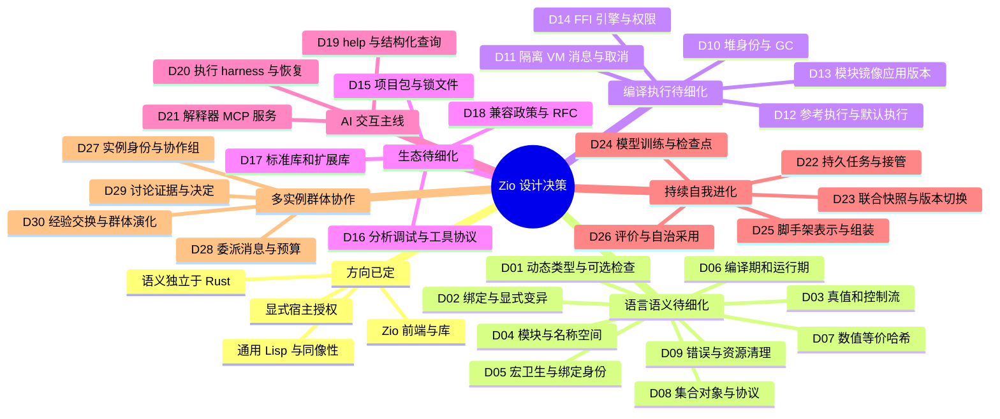

# Zio 关键设计决策

日期：2026-10-15。状态：**讨论草案**。现行语义见[语言参考](language-reference.md)，本文件的“建议”均未自动采纳。已采纳的 ADR 继续有效；本表提出的调整需新 ADR 明确替代关系。

用户补充确认的方向：语言应让 AI 可查询、可执行、可探索，以 Common Lisp condition/restart 为恢复核心，并支持解释器作为 MCP server。D09 调整优先级，新增 D19–D21；具体 API/协议与实现仍待评审，详见[AI 交互设计](ai-language-interaction.md)。

进一步对照 Groiz，新增 D22～D26，承接持续运行、自行改代码、训练模型与组装脚手架的目标。结论是现有方向相容但尚不充分；[持续演化评审](continuous-evolution-design.md)区分已有源码/合同、入口缺口和新建议。自动采用政策仍待确认，现有人工批准合同不被本草案改变。

多个自主实例的联结、分工和讨论新增 D27～D30；[群体协作设计](collective-intelligence-design.md)建议先用三个已知实例、每任务组一个持久协调职责，验证独立状态/预算下的委派与有界讨论，再扩展网络拓扑。

阅读入口：[评审依据](language-ecosystem-review.md) · [路线图](ecosystem-roadmap.md) · [交互式总图](design/zio-design-decisions.html) · [图表源 JSON](design/zio-design-decisions.json)。总图聚合决策，下面的 D 编号是后续 RFC、issue 和 PR 的稳定引用。

## 思维导图



## 先决定哪些问题

先处理 D02/D04/D06/D07/D09，并同步设计 D19–D21。D09 的最小 condition/restart 不再等待完整 MOP；D19 查询、D20 实验和 D21 MCP 是 AI 用户旅程的主线。D10/D11 先做设计与原型，远程暂停恢复须与控制帧、GC roots 和资源生命周期共同验收。D15/D18 与早期语义工作同步设计，防止发布包先冻结不清楚的合同。

| 编号 | 关键问题与现状 | 备选及取舍 | 建议、迁移代价与通过条件 |
| --- | --- | --- | --- |
| D01 | 是否把静态类型变成语言前提？当前 Value 为动态类型，ZOS 为运行时类 | 动态核心：REPL/宏自然；渐进类型：需明确边界检查；静态核心：影响宏、eval、自举与互操作 | **保留动态核心**，先做可选静态诊断/运行时契约；检查缺席不改变执行结果。完整类型系统单独 RFC。示例和错误在三执行面一致 |
| D02 | `def` 当前作用域定义；`set!` 可隐式创建；`let/let*` 均顺序 | 保留现状最兼容；严格赋值能捕获拼写错误；全不可变会大幅改变闭包与 REPL | **严格赋值、顺序 let、显式可变单元方向**；不立即要求所有现有 binding 声明 mutable。先决定 binding/cell 身份与 REPL 重定义规则；版本门控并提供 lint；捕获变异/遮蔽/前向定义合同覆盖 |
| D03 | 真值只有 nil/false；空列表独立；and/or 语法与函数值不同；loop 与 let 初始化范围不同 | 保留 Lisp 特有行为；统一空值会破坏数据；特殊形式与同名严格函数并存易混淆 | **保留真值及 nil/空列表区别，固定尾位置和初始化规则**；and/or 作为语法，逐步弃用有歧义的同名函数值。用直接调用、apply、高阶调用与副作用语料验证迁移 |
| D04 | `:as` 是 map 且默认 refer 全部；module/package 两套概念 | 保留 map alias 最兼容；真正 namespace alias 更利于静态解析；隐式全导入方便但易碰撞 | **显式 refer，提案真正 alias/name 解析**；map alias 兼容 API 单独保留。明确导入是值快照还是 live binding、重导出/循环/重载政策；工具与 compiler 同步，冲突须诊断 |
| D05 | datum 宏与 syntax-rules 卫生子集并存 | 全不卫生灵活但碰撞；完全 syntax object 迁移成本高；双入口需明确边界 | **保留低层 datum 宏，新增有词法身份的 syntax 合同**；不是按名称 gensym 就完成卫生。跨模块 shadow/literal/free identifier、嵌套展开及原始来源须有回归 |
| D06 | AST 运行到宏调用才展开，compiled 在编译期展开；helper/局部捕获有阶段限制 | 任意 compile-time eval 简单但不可重现；完全纯宏限制扩展；显式 build capability 可审计但多一层接口 | **显式展开期依赖与能力**；项目记录编译输入和宏依赖，交互模式规则另明示。阶段性 I/O 次序允许不同，普通运行语义需一致；宏变化须让缓存失效 |
| D07 | i64/f64、截断除法、部分回绕；等价/哈希按类别与 float bits | 统一数值等价直观但要重做 hash；类型敏感等价较稳定；任意精度增加运行时与 FFI 成本 | **v1 先保留类型敏感结构等价与 i64/f64，统一溢出政策**；数值近似/跨类相等另命名提案。明确 ±0、NaN、序列、identity 和可哈希 key；equal 必须同 hash；迁移时提升制品版本 |
| D08 | map-backed set；ZOS 类/GF/method 子集；protocol 库基于 GF | 将所有集合改成对象会扩大核心；独立 Set 增加值/序列化分支；维持 map-backed 最小但会失去种类区别 | **先冻结集合协议和最小 ZOS 合同**，单独决定 Set 是否需要独立身份；保持现有 ZOS 核心方向。明确 slot 变异、accessor/initarg、类重定义和缓存失效，protocol 不另造竞争分派机制 |
| D09 | catch 后匹配优先、`*error*` 为字符串、无 finally；用户指定 condition/restart 为核心 | 只有异常/Result 易实现但无法保留恢复现场；完整 CL 兼容较大；最小动态 condition/restart 可先闭环 | **早期实现结构化 condition、未退栈 handler、动态 restart 查询/调用及清理**，不等待完整 MOP。区分 restart-case 控制转移与返回式恢复；同名实例、参数检查、失效、嵌套与取消需验收。保留旧 catch 版本边界，远程暂停不由同步 handler 自动获得 |
| D10 | Arc/Rc 捕获与引用环；镜像已有身份编码 | RC 加环检测迁移较小但 roots 仍复杂；追踪 GC 可回收环；移动 GC 需稳定 handle；Weak 捕获会改变闭包生命周期 | **先验证非移动追踪堆/稳定 handle 原型**，不预定完整重写。列出 VM、Env、ZOS、FFI、宏与镜像 roots；逃逸闭包有效、环可回收、外部句柄释放、长会话内存平台期是通过条件 |
| D11 | future 同步，channel 可阻塞；Value !Send；ADR-014 线程 VM/CSP 方向已采纳 | 共享堆线程需锁与 GC 协议；隔离 VM 易分权但要消息编码；协作调度适合 I/O 但仍不等于并行 | **细化隔离 VM + 可传递消息子集**，先定义任务/取消/超时/背压；原生线程后端须证明类型安全，browser Worker/WASI 逐项声明。禁止任意闭包/JS handle 直接跨 VM；需 ADR 补充采纳 |
| D12 | AST、元循环、显式 VM 共存，默认源码仍 AST | 立刻 VM 默认减少路径但风险大；永久独立语义维护成本高；按覆盖门槛渐进切换可回滚 | **一份语言合同，多实现共测**；AST 留作引导/参考，VM 达到语义/工具/目标门槛后再决定默认。自举固定点与真实程序验收分开；JIT/AOT 由 profiling 驱动 |
| D13 | `.zioc`、image、bundle 各有合同；WASI 逐应用编译 | 锁 runtime 版本最简单；兼容读取器增加维护；全平台统一镜像需限制 portable 子集 | **语言/stdlib/bytecode/image/ABI 独立版本协商**；首版允许精确 runtime 匹配并明确拒绝。保存静止状态，动态能力必须保留或显式封闭；用户不依赖 Rust 的 WASI 模板/载荷方案须单独完成 |
| D14 | native JS 与 browser bridge 分离；Rust engine/inline 规划 | 每引擎自定义接口快但碎片化；过早通用接口会阻碍实际集成；先共同最小合同可演进 | **先完成原生/浏览器共用 JS 绑定合同，再扩 Rust 与 inline**；声明目标、值转换、identity、回调、Promise、异常、预算和授权。未知 capability 明确拒绝；Rust ABI 不传不稳定 Rust 布局 |
| D15 | require 加载模块，未构成包管理 | 单一 registry 体验统一但初始运维重；path/git 可先离线闭环；依赖冲突自动多版本会影响模块身份 | **先 path/git + 锁文件 + 摘要 + 离线缓存**，初版冲突显式拒绝。manifest 文件格式待 RFC；定义包/模块身份、目标条件依赖、语言约束和 macro deps；干净环境可复现构建后再上 registry |
| D16 | LSP/formatter/grammar 已有；分析规则多处维护 | LSP 执行用户宏语义强但有副作用；仅语法分析安全但不完整；共享无副作用分析 + 受控显式展开较平衡 | **统一符号/模块/来源/诊断合同**；不要求 parser 实现完全相同。项目 check、LSP、compiler 对同源同配置给相符解析；断点须回到原源码，宏来源链保留；文件打开不运行用户代码 |
| D17 | std 与 Rill/Numa/Loom 等成熟度不一 | 全捆绑便捷但发行重；全外置难上手；小 std 加可选官方包可分层维护 | **core → std → 官方扩展 → 第三方**。std 先集合、文本、错误、I/O、路径、测试、时间/随机的可注入边界；Rill 作首个依赖样板，Numa/Loom 按独立需求验收；每库需 API、示例、合同和版本 |
| D18 | 历史 Phase、ADR、工作包、能力矩阵重叠 | 一份大文档简单但难审阅；多份无权威边界会漂移；分工清晰并由证据链接可维护 | **RFC 提案 → ADR 采纳 → reference 规范 → matrix 状态 → 验收证据**；路线图只排依赖。1.0 前明确 breaking policy，1.0 后实施兼容窗口；语义、包 API 和制品格式分别版本化 |
| D19 | 当前源码注释可生成静态库文档，缺统一运行时函数发现入口 | 只给帮助文本易上手但机器难检索；复制 AI 文档会漂移；结构化符号目录可供所有工具共用 | **源码元数据 → describe-symbol/apropos/capabilities → help 展示**；查询按模块/符号身份与 revision，类型/效果未知就标未知。查询不执行函数、宏、getter 或例子；REPL/LSP/MCP/doc 信息一致 |
| D20 | 已有执行/观察/预算与 Loom provider harness，尚非可暂停语言实验环境 | 无状态 eval 简单但丢上下文；持久会话便于试验但需生命周期；任意续体/自动回滚成本高 | **显式会话的语言执行 harness**：编译/运行/事件/限额/取消，逐步接本地及远程 restart。授权范围内可自由实验；暂停帧成为 roots，不能同时改写现场；外部副作用不承诺自动回滚，重复恢复请求须去重 |
| D21 | 用户提出解释器可直接作为 MCP server，当前未发现该实现 | 另造求值器会语义分叉；每个函数变 tool 易膨胀；少量稳定 tools 加查询/执行句柄可演化 | **解释器服务模式 + MCP adapter**，共享 bootstrap、compiler 与 harness，先本地 stdio。显式 session/run/epoch，不把连接当语言会话；协议 stdout 与程序输出分离；远程恢复能力单独声明；不要求内置 LLM |
| D22 | 交互暂停不能跨进程；Groiz 有 owner/lease/队列参考，完整 canonical 闭环仍有缺口 | 把全部状态留 VM 简单但丢进度；任意进程快照成本高；显式 durable job 可按方法恢复 | **持久 job/attempt/event/预算 + epoch fencing/幂等/检查点**；本地 restart 与跨崩溃恢复分开。旧回执不能覆盖新 owner，unknown 结果需对账，fork/resume 不复制额度；与 R2/R3 共验收 |
| D23 | 代码、模型、脚手架及模块 cache 可能独立变化 | 原地重定义即时但易混版；逐请求重建简单但成本高；不可变版本加固定引用支持受控切换 | **ApplicationSnapshot 绑定 P/θ/H/L、runtime 与状态 schema**；新 context 预热，新任务固定新版，旧任务保持旧依赖并 drain。迁移/回退单独验证，代码回退不撤销外部动作；堆/制品回收分别保留 roots |
| D24 | Groiz 有 CPU 许可图/Adam/RNG/checkpoint 路径，不能推断任意模型可训练 | VM 内重写计算扩核心；统一 train-anything 会隐瞒能力；版本化后端/job 合同可逐项扩展 | **Numa/adapter 声明 inference/train/adapter/export/resume/cancel 能力**；代码/结构和参数联合候选有固定数据/recipe/基线。权重初始化与完整续训区别明确，optimizer/sampler/RNG 等按方法保存；先验收小型 CPU 模型 |
| D25 | 用户希望自组脚手架；当前查询与 eval 尚未定义工具/记忆/路由的版本对象 | 只生成文本难检查；全硬编码不能演化；声明描述与受限代码组合可编译验证 | **工具、工作流、上下文/记忆、模型路由与恢复/资源声明成为可读候选 H**；允许有界分支/循环，不强迫全部 DAG。编译产生依赖/效果闭包；组装不自动扩大能力；同任务评价质量与总成本 |
| D26 | Groiz 正式采用当前要求人工批准；持续自治需要新策略 | 全人工可控但闭环等人；不设评价会自证成功；预授权策略可在范围内自动采用 | **保留人工模式，提案独立 PolicyDecision 模式**；策略绑定候选/评价/基础版本/预算/范围，不伪造 HumanApproval。分阶段采用、线上观察、状态兼容与回退须验收；本轮不启用自动发布 |
| D27 | 当前 population/worker 是内部研究单位，用户希望多个 Groiz 自主实例联结 | 全部共享 store 简化但耦合身份/权限；完全 P2P 需更多冲突机制；独立实例加任务组可先验收 | **实例独立持状态、版本、预算，协作组持目标/成员/角色与规则**；首轮三个已知成员、每任务组明确 owner。角色按能力分配，可同时参与不同组；声明版本/身份真实验证，不把新端点自动视为可信 |
| D28 | 跨实例网络会重复/丢失/迟到；不能直接复用本地 channel 当可靠委派 | 同步 RPC 简单但超时含义模糊；可靠消息加持久任务可接管；全局无限共享额度会复制预算 | **offer/accept/attempt + outbox/inbox + epoch/去重/取消/配额**；组与实例账本明确计费权威，转包不复制额度，未知外部效果对账；断网时新授权保守等待，旧结果不覆盖接管任务 |
| D29 | 多实例讨论不自动提高正确性，也不能无限往返 | 自由群聊灵活但难收敛；投票简单但错误可相关；有议题/证据/限额与决策规则较可检验 | **独立提案→证据共享→质疑/有限修订→决定或保留分歧**；固定目标、责任者、轮次/成本/结束条件；讨论消息是数据，执行/采用需显式任务和决定，质量仍由独立评价判断 |
| D30 | 实例可共享经验/代码/模型/脚手架；错误来源循环与环境不兼容会放大问题 | 复制全部记忆简单但失去来源边界；仅摘要可能遗漏证据；不可变引用/来源及本地验证可渐进推广 | **交换获准知识和制品，保留原始来源、版本、兼容与撤回**；转述不算独立证据，接收不等于采用。群体角色/路由/讨论可成为脚手架候选，绑定组配置；任意权重平均/联合梯度训练另设合同 |

## 决策记录模板

每个决策提升为 RFC 时，记录以下字段；未明确“已采纳”前只用于讨论。

```text
ID / 标题 / 状态：提议 | 实验 | 已采纳 | 被替代
问题与用户例子：现有程序怎样受影响
约束：现行语义、目标、性能与宿主边界
选项：至少两种；各自复杂度与放弃的能力
决定与理由：由谁在何时采纳；替代哪个 ADR
兼容：旧源码、标准库、模块、镜像、FFI、工具如何迁移
验收：正例、拒绝例、跨执行面/目标行为及资源观察
证据：commit、命令、真实结果、跳过项与限制
回退条件：什么结果会使本决定重新评审
```

## 第一轮建议讨论顺序

1. D02/D04：允许怎样定义、修改和导入名称？先拿现有库做碰撞/拼写错误例子。
2. D06/D05：编译时能访问什么？跨模块宏怎样找到 helper，怎样保留来源？
3. D07/D08：哪些值相等、可作 key、保留身份，Set 是否需要独立类型？
4. D09：condition 如何通知未退栈 handler，怎样查询/调用 restart，控制转移与资源清理如何协作？
5. D10/D11：闭包、对象、宿主句柄怎样活下来，任务之间怎样传递数据？
6. D15/D18：怎样安装依赖、复现构建并升级语言，而不破坏旧项目？
7. D19–D21：Agent 怎样发现功能、运行小实验、检查条件并恢复同一次计算？首个 MCP 子集怎样明确能力边界？
8. D22～D26：哪些任务必须跨进程存活？怎样绑定代码/模型/脚手架与状态，采用新版并证明实际收益？自动采用的预授权范围如何确定？
9. D27～D30：实例如何识别彼此、接单/拒绝、对账和退出？讨论如何结束、保留分歧并形成可验证的成果？与相同总资源的单实例相比有什么收益？

每轮产出一份可执行语义语料与采纳记录，再进入实现。只在图上选择一个分支，不构成语言规范变更。
