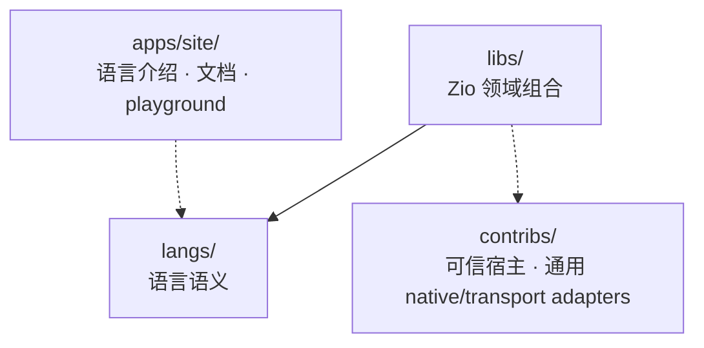

# Zio 系统架构

> Version 0.9 — 语义独立工具链与镜像双主线（2026-10-11）
>
> 本页区分可检查源码、L00–L02 语义与首轮自举验收及规划目标；当前程序写法见[语言参考](language-reference.md)，实跑证据见主计划 L00–L02。
> 权威目标见[语言与工具链规格](superpowers/specs/2026-10-11-zio-language-toolchain-design.md)，
> 实施依赖见[主计划](superpowers/plans/2026-10-11-zio-language-toolchain.md)。
> 历史实跑与数量分别见[特性矩阵](feature-matrix.md)和[项目状态](status.md)；
> 旧目录/业务迁移计划保留历史证据，不替代当前目标和验收。

## 1 语言优先的职责边界

Zio 是语义独立的通用 Lisp。ZOS 仍属于语言核心；库和应用不是语言内置组成。
Rust 是引导与机制层，承载 Reader、值/内存、执行后端、可信宿主及必要原语；
语言语义的权威合同不永久绑定 Rust trait。reader、求值器、展开器、分析器与
编译器目标由 Zio 表达；当前 Rust Reader 是引导基础。领域组合、策略与库也
优先用 Zio，当前源码存在不等于完整自举已验收。

| 层 | 当前物理位置 | 职责与状态 |
|---|---|---|
| 语言 | `langs/core/`、`langs/cli/`、`langs/core/assets/compiler/` | Reader、AST evaluator、宏、Experimental ZOS、字节码运行时、Zio 编译器与普通 CLI；直接平铺，不设 `langs/zio` |
| 标准库 | `libs/std/` | Zio `core.zio`、persistent、entity、protocol、pipeline、datalog；状态分别以特性矩阵为准 |
| 领域库 | `libs/numa/`、`libs/loom/`、`libs/learning/` | Zio vector、agent/proposer、learn/memory 与学习子模块；不因目录迁移而新增功能或发布包 |
| 基础设施 | `contribs/native/loom/` | 已有通用 Rust 模型/工具合同、预算、传输与教师适配；Rust crate 名仍为 `loom`，不是 `libs/loom/` 的 Zio 库 |
| 语言工具适配 | `contribs/language-server/`、`contribs/tree-sitter-zio/`、`contribs/editors/` | 已有 LSP、grammar/queries/parser 与编辑器资源；存在事实不代表完整协议/发行验收 |
| 语言站点 | `apps/site/` | 语言介绍、文档与 WASM playground |



> 应用业务用 Zio 表达，`libs/` 组合领域能力，`langs/` 定义语言语义；
> 可信宿主与传输适配器留在 `contribs/`；站点内嵌由 `langs/core` 构建的 WASM 引擎，
> 独立承载语言文档与 playground。

核心不反向依赖应用业务或通用 harness。普通 `zio-cli` 只装配语言环境，
不提供 `--llm-replay`；模型与 replay 合同仍由 `contribs/native/loom/`
及明确装配它的应用/宿主管理。

## 2 已完成的结构切换与未完成的业务迁移

2026-10-07 首轮切换移动了源树、库文件与消费路径，取消旧根目录入口，
没有兼容别名、symlink 或空占位目录。它不改变下面的能力验收口径：

- Rust 引导实现仍在 `langs/core/`；当前已有 bytecode 运行时和 `langs/core/assets/compiler/compiler.zio`，
  `langs/core/assets/interpreter/` 提供 Zio reader／元循环 evaluator／expand；L02 已验收完整 Zio 前端三代便携字节码固定点，镜像及优化 ZIR/JIT 仍属规划。
- `.zio` 库已归入 `libs/`；Datalog 已有合取查询子集，规则、聚合等完整能力仍按特性矩阵区分，不能用目录迁移替代功能验收。
- `contribs/native/loom/` 保留可复用 native transport/host adapter，
  不把其整个 Rust 实现当成未来 Zio Loom 库的目标本体。
- `contribs/language-server/` 与 `contribs/tree-sitter-zio/` 已有实现，不能再称为不存在。
  当前工具源码与目录迁移都不证明完整开发发行或工具链自托管已完成。

下表是历史 Linux x64 实跑证据，本轮没有重跑，也不泛化为当前分支或其他平台验收。
目录迁移只证明结构归属；字节码、自举和工具链的现有源码见 §3.3。
结构切换命令、警告与验收记录见[首轮计划](superpowers/plans/2026-10-07-language-first-layout.md#verified-integration-results-2026-10-07)。

| 表面 | 已观察到的证据 |
|---|---|
| Rust workspace | `cargo test --workspace --all-features`：491 passed，48 suites，0 failures |
| 普通语言 CLI | 首轮：basics、ZOS、learn 示例实际运行；后续：混合数值排序实跑。CLI 的直接依赖为 `im` 与 `zio-core`，不再含 Loom |
| 构建与站点 | 首轮：WASM、Astro、Docker 镜像与 nginx 46 页通过；后续：重建 WASM/Astro，47 页构建通过，未重新构建 Docker 镜像 |
| 浏览器 | 首轮：多行编辑、持久定义、reader 错误恢复与 390/768/1024 宽度验证；后续：六个真实 WASM 预设、混合数值排序和 Ctrl+Enter 实跑，390px playground 无观察到的横向溢出，桌面与移动端截图已检查 |
| 状态与限制 | `tools/project-status.sh --check` 通过；默认 feature 的测试清单为 476，不等同于全 feature 实跑数量。自举编译器及其他平台验证未完成 |

## 3 当前组成与演进方向

### 3.1 原生 workspace 与 Zio 库

```text
langs/cli/ (zio-cli：REPL、脚本、模块根配置)
└── langs/core/ (zio-core：Reader、AST eval/apply、bytecode、ZOS、WASM 入口)
langs/core/assets/compiler/compiler.zio (Zio 编译器，消费运行时机制)
contribs/{language-server,tree-sitter-zio,editors}/ (语言工具与编辑器适配)
contribs/native/loom/ (loom：通用 native harness/transport)
libs/{std,numa,loom,learning}/ (Zio 源文件，不是 Rust workspace crate)
```

具体 Cargo feature 与依赖以实际 manifest 为准，不在文档复制固定 crate/测试数量。
`libs/loom/agent.zio` 提供通用 agent 循环 `agent-run`，`libs/loom/proposer.zio` 是提议器。
`libs/learning/` 持学习与记忆组合，`libs/numa/vector.zio` 持向量计算，
学习/评价/发布治理不进入通用计算或传输适配器。

### 3.2 目标库与应用

Numa（计算）、Rill（CLI 组合）、Loom（harness）是 Zio 领域库方向，
不再以独立 Rust 业务库为目标。`libs/rill/cli.zio` 已有参数、子命令和帮助解析组件；
正式短名不保证注册表包 ID 或已发布版本。只在真实消费需要时补齐公开合同。
Groiz 是独立项目（[lszio/groiz](https://github.com/lszio/groiz)），不在本仓库；
语言仓库不承载其业务与落地页。应用侧的可信授权、事务、隔离和原生后端
仍按明确合同保留必要宿主边界。

### 3.3 工具链：当前来源与规划验收

| 能力 | 可检查来源 | 本轮状态与边界 |
|---|---|---|
| AST 求值与语言引导 | `langs/core/`、`langs/cli/` | 默认执行器保持不变；L00–L02 原生/便携 VM/WASM 合同实跑，不新增性能或其他平台结论 |
| 字节码执行与模块制品 | `langs/core/src/bytecode.rs` | 有 opcode、闭包、模块与序列化机制；模块制品不等于运行时镜像 |
| Zio 编译器 | `langs/core/assets/compiler/{analyze,compiler}.zio` | Zio 表达绑定/捕获/global 选择、尾位置、展开与代码生成；Rust 保留 VM/wire/值与投影机制 |
| 自举对照测试与 CLI | `langs/core/tests/self_hosting.rs`、`tools/smoke-self-build.sh` | L02：fresh context 安装整个前端，Stage 1/2/3 文件字节相同，编译执行 sum=10、closure=15；缺失 helper 不回退 Stage0 |
| LSP 与语法资源 | `contribs/language-server/`、`contribs/tree-sitter-zio/`、`contribs/editors/` | 已有代码/资源；完整功能、安装与发行仍需验收 |
| 元循环求值器 | `langs/core/assets/interpreter/`、`langs/core/src/interpreter.rs` | 显式第三执行面：Zio reader/eval/apply/expand；同一实现纳入 L02 编译前端，Rust 引导与宿主机制保留 |
| 运行时镜像、bin/WASM 导出、完整开发发行 | 新规格与主计划 | M00/M01 已验收图格式与静止镜像保存/恢复；镜像 CLI（M02）、导出与发行仍属规划 |

第一条主线以现有 AST、bytecode、Zio 编译器为引导基础，固定语言语义与
源码位置合同，补齐 Zio 元循环求值器和编译前端，验收编译器产物运行并编译自身、
规范化产物固定点及各执行路径行为一致。应用业务迁为 Zio、LSP 自托管或站点
运行 WASM 都不等于这项自举验收。完整 MOP 与优化 ZIR/JIT 分别演进，不是
首轮镜像/发行的隐含前提。

### 3.4 镜像、应用产物与发行

第二条主线建立版本化运行时对象图格式，保存/恢复已建立的环境与代码绑定。
对象身份、共享引用、循环与闭包捕获必须保持；不能用独立 JSON 树复制值来冒充镜像。
外部文件/连接/线程/引擎句柄只允许显式重建，无法重建就拒绝；
恢复时重新授予宿主能力，不继承源进程权限。不是任意 OS 进程快照，
也不承诺任意引擎状态恢复。同 runtime/格式版本的 portable 子集要求跨
native/browser/WASI 恢复；平台资源仅在匹配 profile 与恢复器下恢复，否则拒绝。

以源码为输入，四类产物为完整开发发行版、编译模块（便携字节码）、
运行时镜像与应用产物。native bin、WASM-browser、WASM-WASI 是应用产物子类型。
首轮 bin 封装 bytecode/初始镜像 + runtime，不是机器码 AOT；浏览器 WASM 与
WASI 分别列宿主能力和验收，当前浏览器入口不证明 WASI 已交付。
完整开发发行同时交付解释器、编译器、LSP、语法/编辑器资源、WASM 与文档；
最小应用产物只带运行所需机制、库和引擎，可裁剪开发工具。独立应用（如 Groiz）
是独立消费者，不进入语言发行必要组成。

### 3.5 外部引擎库与 inline

解释型和编译型外部语言都通过引擎库接入；Zio 核心不吸收各外语语义。
`inline` 是外语源码入口，不是所有引擎必须提供 `eval`：执行、编译模块或
生成制品由引擎合同决定，值转换、错误、资源生命周期与授权必须显式。
这些通用 API 是规划，不在本轮宣称实现。

当前 JS bridge 仅在 WASM；`js` dotted resolver 仅在解释器路径，
native CLI 没有 JS 引擎。外部 JS 生态接入目标不能被这两个特定入口替代，
也不意味着已有 bytecode 自动支持 JS inline。

## 4 规划性能目标

当前可复现的 AST 测量见[AST evaluator baseline](../benchmarks/README.md)。
字节码运行时已有源码，不代表本轮验证加速；优化 ZIR/JIT 为规划。

本页不复制某台机器上的当前耗时。已批准设计中的 VM/JIT 性能数字仅是未来
验收目标；比较必须使用 AST baseline 文档规定的相同 workload、engine、
release build 与 machine metadata。

## 5 跨平台目标

| 目标 | Rust target | 状态 |
|------|-------------|------|
| Linux x86_64 | `x86_64-unknown-linux-gnu` | 开发与历史运行验证平台；本轮未运行 |
| macOS ARM | `aarch64-apple-darwin` | 目标平台，本轮未验证 |
| macOS x86_64 | `x86_64-apple-darwin` | 目标平台，本轮未验证 |
| Windows | `x86_64-pc-windows-msvc` | 目标平台，本轮未验证 |
| 浏览器 WASM | `wasm32-unknown-unknown` | 已有 playground/JS bridge；独立产物与发行验收另列 |
| WASI | 目标与能力合同由新规格固定 | 规划；不由浏览器 WASM 实跑证明 |
| ARM Linux | `aarch64-unknown-linux-gnu` | 目标平台，本轮未验证 |

---

## 6 相关文档

| 文档 | 内容 |
|------|------|
| [zio-philosophy.md](zio-philosophy.md) | 语言哲学、设计定理、设计原则 |
| [feature-matrix.md](feature-matrix.md) | 权威能力状态与证据 |
| [status.md](status.md) | 自动生成的仓库事实 |
| [eval-pipeline.md](eval-pipeline.md) | Eval 循环、TCO、宏系统、编译器管线 |
| [zos-spec.md](zos-spec.md) | ZOS 完整规范（Class/GF/Method/MOP/Condition） |
| [roadmap.md](roadmap.md) | Phase 路线图、交付标准、依赖分析、应用蓝图 |
| [adrs.md](adrs.md) | 架构决策记录（ADR-001 ~ ADR-019） |
| [glossary.md](glossary.md) | 术语参考 |
| [superpowers/plans/2026-10-07-language-first-layout.md](superpowers/plans/2026-10-07-language-first-layout.md) | 当前目录切换合同；旧 T/C/I/H/G 与 W 计划保留历史证据 |
| [语言与工具链规格](superpowers/specs/2026-10-11-zio-language-toolchain-design.md) | 当前语义独立、元循环/自举、镜像与发行目标 |
| [主计划](superpowers/plans/2026-10-11-zio-language-toolchain.md) | 当前工作包、依赖与验收顺序 |
